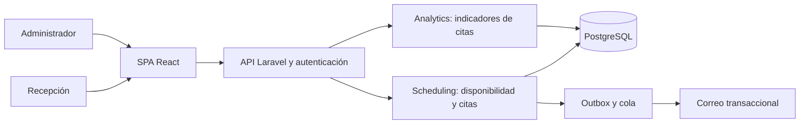
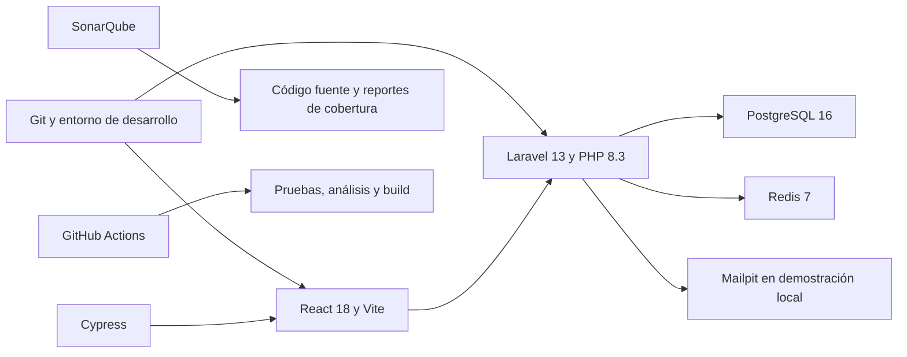

# Calidad del proceso de gestión de citas odontológicas en DentiCore

## Propósito y alcance

El producto académico evalúa y mejora el proceso de citas del proyecto existente DentiCore. El resultado esperado es demostrar la reserva sin cruces, la gestión posterior de las citas y un reporte funcional que permita identificar cancelaciones e inasistencias. Se entrega el proyecto actualizado y un informe individual con evidencias verificables.

La unidad de trabajo es una clínica. Recepción consulta disponibilidad, reserva, confirma, reprograma, cancela y registra la llegada. El administrador configura previamente los odontólogos, horarios, bloqueos y tipos de cita. Los pacientes ya registrados son una precondición; su alta no forma parte de los cinco escenarios principales.

El límite del proceso es el registro de llegada. La apertura de la atención que ya produce el check-in se conserva, pero el registro clínico posterior queda fuera de la evaluación. También quedan fuera tratamientos, presupuestos, pagos, IA, predicción de caries, encuestas y autoagendamiento del portal. Las pruebas existentes de esos componentes se mantienen como regresión.

Todo dato de demostración será sintético y estará almacenado en el sistema. Un registro sintético persistido permite demostrar la integración del reporte con la base de datos; no demuestra una mejora real en una clínica. El informe distinguirá resultados medidos del software, beneficios potenciales y resultados de negocio todavía no medidos.

## Fuentes y estado inicial

| Fuente | Aplicación |
| --- | --- |
| SRS §7.2, §11.13 y §12.11 | Flujo de citas y reglas RF-146, RF-147 y RF-149 a RF-153. |
| SRS §7.2.6 y RF-195 | Indicadores de citas y filtros por fechas y odontólogo. |
| SDD §4.3.8 | API existente de agenda y notificaciones. |
| SDD §4.3.12 | Rutas previstas de indicadores y autorización del administrador. |
| Informe TCR-E1 y guion de demostración E1 | Evidencia histórica del flujo ya implementado; no sustituye una nueva ejecución. |
| Guía práctica individual suministrada por el estudiante | Cinco actividades académicas, mínimo cinco escenarios Cypress y evidencias de ejecución. |

La base local inspeccionada es `main`, commit `73b1dbc`. La documentación de E1 declara Playwright y SonarCloud. El producto académico incorpora Cypress y un análisis con SonarQube; se conservarán las herramientas existentes. Las métricas históricas no se presentarán como resultados de las nuevas ejecuciones.

## Arquitectura del proceso

La API es un monolito modular. La SPA consume su API REST; el módulo Scheduling aplica las reglas de negocio y PostgreSQL protege también la no superposición de citas del paciente y del odontólogo. El reporte agrega registros de la misma clínica sin enviar identificadores de pacientes en los resultados.

Scheduling, PostgreSQL, outbox y correo representan la base existente. Analytics representa la ampliación planificada; su presencia en este diagrama no significa que ya esté implementada. Las notificaciones existentes se respetan, incluido el consentimiento por finalidad. No se añade una API externa para cumplir artificialmente la práctica.

El procedimiento base de ejecución está en `INSTALACION.md`. Se registrarán las versiones efectivamente ejecutadas, sin presentar un entorno local como despliegue de producción.

## Escenarios Cypress

Se ejecutarán sobre la interfaz real y la API real, sin interceptar respuestas del negocio para simular éxitos. La preparación puede usar fábricas o mecanismos existentes sobre una base de pruebas aislada. Cada escenario tendrá sus propios registros y podrá ejecutarse sin depender del anterior.

| ID académico | Funcionalidad y objetivo | Datos y procedimiento | Resultado esperado | Trazabilidad |
| --- | --- | --- | --- | --- |
| AC-CIT-01 | Reservar una cita disponible | Paciente y odontólogo activos, horario futuro libre; iniciar sesión como recepción, buscar paciente, elegir tipo y horario y reservar. | Una cita programada persistida y visible en agenda y detalle. | CUS-46, CUS-47; RF-146, RF-147. |
| AC-CIT-02 | Evitar una reserva superpuesta | Cita existente; simular dos sesiones que seleccionan el mismo horario antes de confirmar y enviar ambas reservas. | Solo una reserva tiene éxito; el conflicto se informa sin crear una segunda cita. | RN-46, RN-74; CA-47.1, CA-47.2. |
| AC-CIT-03 | Confirmar una cita | Cita programada propia del escenario; registrar confirmación desde recepción y recargar. | Estado confirmada conservado tras recarga. | CUS-49; RF-150. |
| AC-CIT-04 | Reprogramar una cita | Cita propia y otro horario disponible; reprogramar desde el detalle. | La misma cita conserva su identidad y cambia de horario; el intervalo anterior queda libre si ningún otro bloqueo lo ocupa. | CUS-48; RF-149. |
| AC-CIT-05 | Cancelar una cita | Cita propia activa; abrir cancelación, indicar el motivo, confirmar y recargar. | Estado cancelada y motivo persistidos; se libera el intervalo y no se borra el registro. | CUS-48; RF-149; CA-47.5. |

Se añadirá una comprobación de llegada dentro y fuera de la ventana de RN-50 si se modifica esa funcionalidad. Las pruebas sensibles a fechas usarán un reloj controlado en el servidor o datos relativos reproducibles; congelar solo el navegador no controla el reloj de Laravel.

Cada ejecución registrará total, aprobadas, fallidas, omitidas, porcentaje de aprobación, duración, commit, configuración y evidencias. El porcentaje será aprobadas dividido entre aprobadas más fallidas, multiplicado por cien; con cero ejecutadas se mostrará no calculable. Una prueba omitida no cuenta como aprobada. Los resultados obtenidos y los defectos se completarán después de ejecutar, nunca a partir del código escrito.

## Reporte funcional de citas

Se implementará una entrega parcial de RF-195, sin declarar terminado todo M12 ni TASK-167. Se aprovechará la ruta prevista `GET /api/v1/analytics/dashboard` y se conservarán `role:clinic_admin`, aislamiento de clínica y `plan.feature:analytics`. Recepción mantiene sus permisos actuales; el reporte corresponde al administrador.

Los filtros serán fecha inicial, fecha final y odontólogo opcional. Las fechas serán inclusivas en la zona de la clínica y se convertirán a un intervalo semiabierto hasta el inicio del día posterior a la fecha final. Se rechazarán fechas inválidas o invertidas. Todos los componentes del reporte compartirán el mismo criterio temporal: fin programado de la cita dentro del intervalo. El filtro de odontólogo de otra clínica responderá 404 y nunca permitirá consultar datos ajenos.

| Indicador | Cálculo | Interpretación |
| --- | --- | --- |
| Total de citas del período | Cantidad de citas cuyo fin programado pertenece al intervalo, incluidos todos sus estados. | Volumen de agenda registrado para el período seleccionado. |
| Porcentaje de cancelaciones | Citas canceladas del conjunto dividido entre total de citas del conjunto, por cien. | Proporción de citas canceladas de esa agenda; no es la fecha en que ocurrió la cancelación. |
| Tasa de inasistencia | Citas en inasistencia cuyo fin ya ocurrió dividido entre todas las citas del conjunto cuyo fin ya ocurrió, por cien. | Respeta el denominador del SRS §7.2.6; las citas futuras no reducen artificialmente la tasa. |

Una tabla o gráfico presentará los conteos por estado del mismo conjunto. Los porcentajes se mostrarán con dos decimales; sin denominador se mostrará sin datos, sin producir NaN ni atribuir un cero medido. El reporte indicará fecha y hora de cálculo y ofrecerá actualización explícita tras cambiar registros; no usará valores estáticos ni una copia del listado paginado para calcular totales.

Se validarán agregaciones con conjuntos conocidos, filtro por odontólogo, límites de fechas en America/Lima, período sin datos, citas futuras, permisos y aislamiento entre clínicas. La interfaz presentará carga, error recuperable y ausencia de datos, conforme al diseño existente.

## SonarQube y evidencias

Se analizará el código fuente del proceso en la misma revisión usada para Cypress. Se documentarán proyecto, versión de SonarQube, alcance de archivos, exclusiones justificadas y comando de ejecución. El token quedará en variables de entorno o secretos, nunca en Git.

El informe registrará Quality Gate, bugs, vulnerabilidades, problemas de mantenibilidad, duplicación y cobertura cuando exista un reporte compatible. La cobertura de Cypress no se deducirá de la cantidad de escenarios; requiere instrumentación y un reporte reconocido. Podrá usarse cobertura obtenida de las suites existentes, identificando su procedencia. Un resultado sin cobertura disponible se declarará como tal.

Se explicarán los hallazgos y se propondrán o aplicarán mejoras con su evidencia. La guía académica no exige aprobar el Quality Gate para su máxima calificación; las puertas que ya exige el repositorio siguen siendo obligatorias para integrar cambios.

## Informe y criterios de aceptación

El informe final incluirá portada individual, descripción de DentiCore y del proceso seleccionado, ambas arquitecturas, Cypress, SonarQube, módulo de reportes, impacto funcional, conclusiones y anexos. Se reutilizará esta definición como alcance, pero las capturas y métricas se obtendrán de ejecuciones nuevas.

- Cinco escenarios Cypress ejecutados sobre el sistema real y documentados con su resultado obtenido.
- Análisis SonarQube ejecutado y métricas interpretadas, sin sustituirlo por capturas históricas de SonarCloud.
- Tres indicadores conectados a registros persistidos, filtros funcionales y visualización por estado.
- Arquitecturas verificadas contra la implementación final, distinguiendo lo existente de lo añadido.
- Beneficios explicados sin afirmar reducciones reales de tiempos o inasistencias que no hayan sido medidas.
- Verificaciones locales aplicables aprobadas antes de cada push, PR hacia main y checks remotos en verde antes del merge.

Las tareas y su orden se registran en la sección 10 del Plan de Implementación. Esta especificación define el recorte académico; no altera los estados de las citas ni introduce tablas nuevas.
